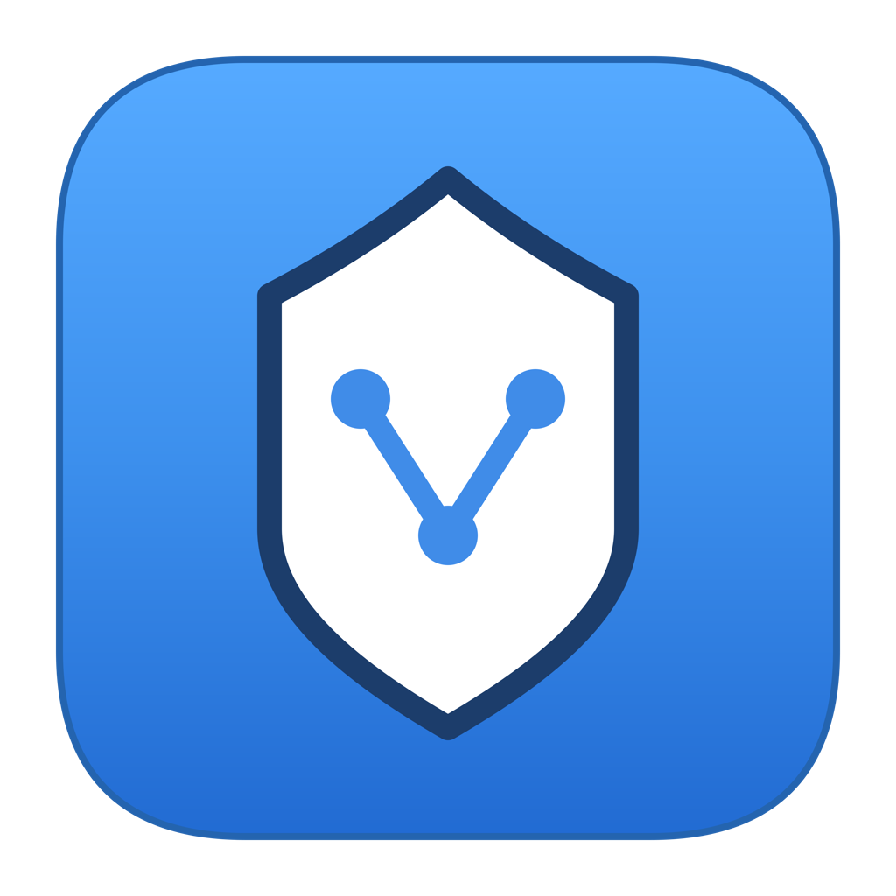
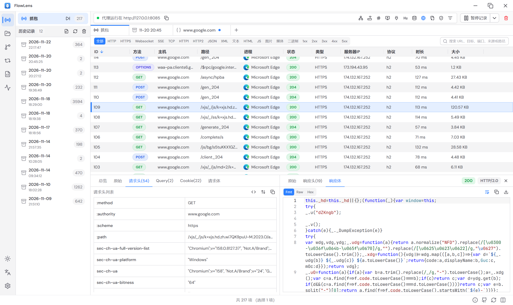
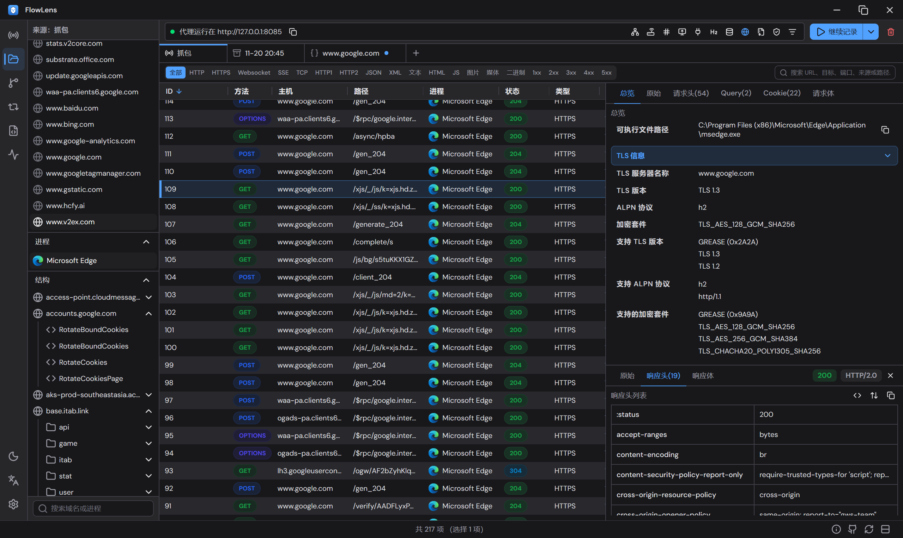

<p align="center">
  
</p>

<h1 align="center">FlowLens</h1>

<p align="center">
  A local-first desktop MITM traffic inspector for HTTP, HTTPS, WebSocket, and SOCKS5 workflows.
</p>

<p align="center">
  <a href="https://github.com/josexy/flowlens/actions/workflows/ci.yml"></a>
  <a href="https://github.com/josexy/flowlens/releases/latest"></a>
  <a href="LICENSE"></a>
</p>

<p align="center">
  <strong>English</strong> · <a href="README.zh-CN.md">简体中文</a>
</p>

FlowLens captures proxy traffic and lets you inspect, edit, replay, and organize requests. It is built in Go with [MyGo](https://github.com/egoist/mygo) and [nuxt-ui-go](https://github.com/josexy/nuxt-ui-go).

## Screenshots

### Light Theme



### Dark Theme



## Highlights

- **Capture:** HTTP/HTTPS MITM, SOCKS5, SSE, and WebSocket traffic. Pause recording without disconnecting clients.
- **Inspect:** Ordered headers and trailers, transport timings, transfer sizes, and text, image, and hex viewers.
- **Send and replay:** HTTP Request Editor and WebSocket Client with proxy selection, TLS profiles, HTTP/2 fingerprints, and shared DNS caching.
- **Rewrite:** Redirect URLs and edit headers, queries, and UTF-8 bodies on live HTTP/HTTPS traffic, with regex previews.
- **Organize and script:** API Collections, local history, traffic categories, and optional Python 3 hooks with a per-tab console.
- **Import and export:** Import HAR files; export capture or history as CSV/HAR, or save individual requests, responses, headers, and bodies.
- **Desktop integration:** Local process attribution, signed updates, shortcuts, themes, and English/Chinese localization. Windows and macOS also offer system-proxy and current-user CA trust controls.

## Install

Download the latest release from [GitHub Releases](https://github.com/josexy/flowlens/releases/latest).

| Platform | Packages |
| --- | --- |
| Windows x64 / ARM64 | NSIS installer |
| macOS | Apple Silicon DMG or universal DMG |
| Linux x64 / ARM64 | Debian package (`.deb`), RPM package (`.rpm`), or a `.tar.gz` archive with `install.sh` |

Linux packages use GTK 3 for the native UI and do not require WebKitGTK.

Verify downloads against `SHA256SUMS`. Windows packages are unsigned and macOS packages use ad-hoc signing (not notarized), so operating-system security warnings are expected on first launch.

Use the status-bar update control to check for releases and choose **Install and restart**. FlowLens downloads and verifies the update before restarting. Installations without write access use the release page. See [Update FlowLens](docs/user-guide.md#update-flowlens) for cancellation and restart options.

Upgrading from 1.0.x requires one manual installation of 2.0.0 or later; existing data is retained.

## Quick Start

1. Start the proxy from the toolbar and point your client at `127.0.0.1:8080`.
2. For HTTPS, open **Settings > Proxy** and use the built-in CA or select your own certificate and private key.
3. Trust that CA in your client. On Windows and macOS, the shield button installs it for the current user; clients with separate trust stores need manual setup.

See the [User Guide](docs/user-guide.md#set-up-capture) for detailed capture, certificate, and system-proxy setup.

## Build from Source

Use the Go version in [go.mod](go.mod) or newer and install [Task](https://taskfile.dev). Application builds use `CGO_ENABLED=0` and need no C compiler or Node.js. Python hooks require an external Python 3 interpreter.

```shell
git clone https://github.com/josexy/flowlens.git
cd flowlens
task dev
```

See [Contributing](CONTRIBUTING.md) for development commands and [Building and Packaging](docs/technical/building.md) for platform requirements, direct MyGo commands, and release packaging.

## Documentation

| Document | Contents |
| --- | --- |
| [User Guide](docs/user-guide.md) | Capture setup, certificates, inspection, history and HAR, Request Editor, API Collections, rewrite rules, shortcuts, settings, and storage |
| [Python Plugin Guide](docs/technical/python-plugins.md) · [简体中文](docs/technical/python-plugins.zh-CN.md) | Python setup, hook API, limits, troubleshooting, and [tested examples](docs/examples/python-plugins) |
| [HTTP Rewrite Rules](docs/technical/http-rewrite-rules.md) | Matching semantics, body processing, limits, and lifecycle |
| [Traffic Metrics and HAR](docs/technical/traffic-metrics-and-har.md) | Timing and size definitions, HAR mapping, HBIN history, recording admission, and capture memory |
| [Building and Packaging](docs/technical/building.md) | Cgo policy, platform packages, signed updates, releases, and [macOS native verification](docs/technical/macos-native-verification.md) |
| [Memory Diagnostics](docs/technical/memory-diagnostics.md) | Idle memory behavior, intentionally retained state, and profiling a running instance |
| [Contributing](CONTRIBUTING.md) · [Engineering Guidelines](AGENTS.md) | Development workflow, testing, and repository contracts |
| [Changelog](CHANGELOG.md) · [Security Policy](SECURITY.md) | Release notes and vulnerability reporting |

## Data and Security

FlowLens stores its data in the operating system's user configuration directory; see [Local Storage](docs/user-guide.md#local-storage).

- Use FlowLens only on traffic and systems you own or are authorized to inspect.
- Listening on `ALL` (`0.0.0.0`) exposes the proxy to every device that can reach the host.
- Protect the MITM CA private key and remove the CA from trust stores when you no longer need it.
- Captures, history, exports, and logs can contain credentials and other sensitive data; exports are never redacted.
- Python plugins run as trusted local code with your user permissions and without a sandbox.

See [Security](docs/user-guide.md#security) in the User Guide for more details, and report vulnerabilities through [SECURITY.md](SECURITY.md) rather than a public issue.

## Contributing and Support

Read [CONTRIBUTING.md](CONTRIBUTING.md) before proposing code or documentation changes. Open a [GitHub Issue](https://github.com/josexy/flowlens/issues) for reproducible bugs and focused feature requests, and strip credentials, captured traffic, private paths, certificates, and unredacted logs before posting.

## License

FlowLens is licensed under the terms in [LICENSE](LICENSE).
