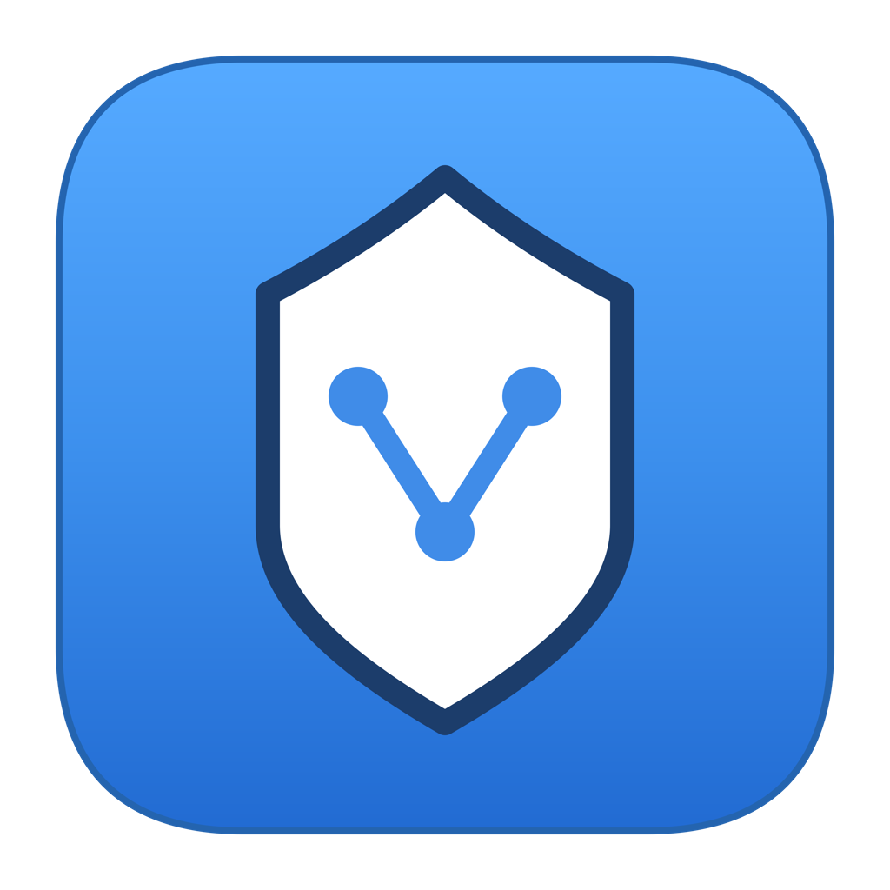

<p align="center">
  
</p>

<h1 align="center">FlowLens</h1>

<p align="center">
  一款本地优先的桌面端 MITM 流量分析工具，支持 HTTP、HTTPS、WebSocket 与 SOCKS5 工作流。
</p>

<p align="center">
  <a href="https://github.com/josexy/flowlens/actions/workflows/ci.yml"></a>
  <a href="https://github.com/josexy/flowlens/releases/latest"></a>
  <a href="LICENSE"></a>
</p>

<p align="center">
  <a href="README.md">English</a> · <strong>简体中文</strong>
</p>

FlowLens 能够捕获代理流量、识别本地来源进程，并支持对请求进行查看、编辑、重放与整理。它是一款使用 Go、[`MyGo`](https://github.com/egoist/mygo) 和 [`nuxt-ui-go`](https://github.com/josexy/nuxt-ui-go) 构建的原生桌面应用程序。

## 界面预览

### 浅色主题


### 深色主题


## 核心特性

- **流量捕获：** 支持 HTTP/HTTPS MITM 抓包、SOCKS5 代理、不断开客户端连接即可暂停/恢复录制、实时 SSE 事件流与逐条消息查看，以及 WebSocket 消息捕获。
- **深度检视：** 保留原始顺序的请求/响应头与 Trailer、微秒级传输耗时、传输体积统计，以及 Text、Raw、Image（支持 SVG、AVIF、ICO）和 Hex 视图。
- **请求工作台：** 内置 HTTP 请求编辑器、请求重发、WebSocket 客户端、灵活的代理选择、uTLS ClientHello 指纹配置、HTTP/2 指纹，以及支持不中断现有连接清空的共享 DNS 缓存。
- **实时重写规则：** 支持对实时 HTTP/HTTPS 代理流量进行 URL 重定向，以及请求/响应头、查询参数和 UTF-8 正文替换，并提供正则替换内联预览。
- **接口集合、历史与脚本：** 支持 API Collections、本地 HBIN 历史记录、流量分类视图，以及可选的 Python 3 请求/响应 Hook 与独立标签页实时控制台。
- **导入与导出：** 支持通过文件选择器或拖拽导入 HAR；支持将抓包与历史导出为 CSV 和 HAR；支持单条导出请求、响应、Header、Body 或完整报文交换。
- **系统集成：** 在 Windows、macOS 与 Linux 上支持本地进程归属与图标显示；在 Windows 与 macOS 上支持托管系统代理和当前用户 CA 证书信任管理。
- **桌面体验：** 支持签名验证的应用内更新、可自定义快捷键、主题配色与独立的界面/代码字号、持久化详情布局，以及中英文双语界面。

## 安装

从 [GitHub Releases](https://github.com/josexy/flowlens/releases/latest) 下载最新版本。

| 平台 | 安装包 |
| --- | --- |
| Windows x64 / ARM64 | NSIS 安装程序 |
| macOS | Apple Silicon DMG 或通用（Universal）DMG |
| Linux x64 / ARM64 | Debian 安装包（`.deb`）、RPM 安装包（`.rpm`），或 `.tar.gz` 压缩包配合 `install.sh` |

Linux 安装包使用 GTK 3 渲染原生界面，无需依赖 WebKitGTK。

请使用 `SHA256SUMS` 校验下载文件。Windows 安装包未签名，macOS 安装包仅使用 ad-hoc 签名（未公证），首次启动时出现操作系统安全提示属于正常现象。

可通过状态栏的更新入口检查新版本。具备写权限的安装目录会在重启后自动下载、验签并应用签名更新；由包管理器安装的版本则会引导至发布页面手动更新。FlowLens 1.0.x 无法直接自动升级到 2.0.0，请从发布页面手动安装一次 2.0.0 及以上版本，原有本地数据会自动保留。

## 快速开始

1. 在工具栏启动代理，并将客户端指向 `127.0.0.1:8080`。
2. 如需解密 HTTPS 流量，打开 **设置 > 代理**，信任内置 CA 证书（全新安装会自动生成），或指定你自己的 CA 证书与私钥（FlowLens 不会覆盖自定义证书）。
3. 在 Windows 与 macOS 上，可点击 **设置 > 代理** 中的盾牌按钮为当前用户安装 CA 证书。

详细抓包、证书与系统代理配置请参阅[用户指南（English）](docs/user-guide.md#set-up-capture)。

## 从源码构建

**环境要求：** Go 1.27.3 或更高版本，推荐安装 [Task](https://taskfile.dev)。常规构建与测试在所有桌面平台上均默认使用 `CGO_ENABLED=0`，无需 C/Objective-C 编译器或 Node.js 工具链。macOS 签名与 DMG 打包仍需在 macOS 上使用系统工具，详见[构建与打包指南](docs/technical/building.md)。仅在使用 Python 请求 Hook 时需要 Python 3（FlowLens 会检测本机解释器，不会自动安装）。

```shell
git clone https://github.com/josexy/flowlens.git
cd flowlens
task dev
```

如未安装 Task，可在设置 `CGO_ENABLED=0` 后运行 `go tool mygo dev`。更多开发命令请参阅 [CONTRIBUTING.md](CONTRIBUTING.md)，发布构建流程请参阅[构建与打包指南](docs/technical/building.md)。

## 文档导航

| 文档 | 内容说明 |
| --- | --- |
| [User Guide（English）](docs/user-guide.md) | 抓包配置、证书管理、流量检视、历史与 HAR、请求编辑器、API Collections、重写规则、快捷键、设置与本地存储 |
| [Python 插件指南（简体中文）](docs/technical/python-plugins.zh-CN.md) · [English](docs/technical/python-plugins.md) | Python 环境配置、Hook API、限制说明、故障排查及[已测试示例](docs/examples/python-plugins) |
| [HTTP Rewrite Rules（English）](docs/technical/http-rewrite-rules.md) | 匹配语义、正文处理、资源限制与生命周期 |
| [Traffic Metrics and HAR（English）](docs/technical/traffic-metrics-and-har.md) | 耗时与体积定义、HAR 映射规则、HBIN 历史格式、录制准入与内存管理 |
| [Building and Packaging（English）](docs/technical/building.md) | Cgo 策略、各平台打包、签名更新、发布流程及 [macOS 原生验证](docs/technical/macos-native-verification.md) |
| [Memory Diagnostics（English）](docs/technical/memory-diagnostics.md) | 空闲内存行为、常驻缓存边界与运行中实例性能剖析 |
| [Contributing](CONTRIBUTING.md) · [Engineering Guidelines](AGENTS.md) | 贡献流程、测试验证与仓库工程规范 |
| [Changelog](CHANGELOG.md) · [Security Policy](SECURITY.md) | 版本更新日志与安全漏洞上报说明 |

## 数据与安全

FlowLens 将所有本地数据保存在操作系统的用户配置目录中，详见[本地存储（English）](docs/user-guide.md#local-storage)。

- 请仅在归你所有或已获授权的流量与系统上使用 FlowLens。
- 监听 `ALL`（`0.0.0.0`）会将代理暴露给所有能够访问本机的网络设备。
- 请妥善保管 MITM CA 私钥，不再使用时及时从系统信任库中移除该 CA 证书。
- 抓包记录、历史、导出文件及日志可能包含凭据与其他敏感信息，导出内容不会自动脱敏。
- Python 插件以可信本地代码运行，拥有与当前用户相同的权限，不提供安全沙箱。

更多安全说明请参阅用户指南中的[安全章节](docs/user-guide.md#security)。如发现安全漏洞，请通过 [SECURITY.md](SECURITY.md) 上报，切勿公开提交 Issue。

## 参与贡献与问题反馈

提交代码或文档改动前，请先阅读 [CONTRIBUTING.md](CONTRIBUTING.md)。遇到可复现的 Bug 或有明确的功能建议，请提交 [GitHub Issues](https://github.com/josexy/flowlens/issues)，提交前务必清除其中的凭据、抓包内容、私人路径、证书和未脱敏日志。

## 许可证

FlowLens 依据 [LICENSE](LICENSE) 中的条款开源。
