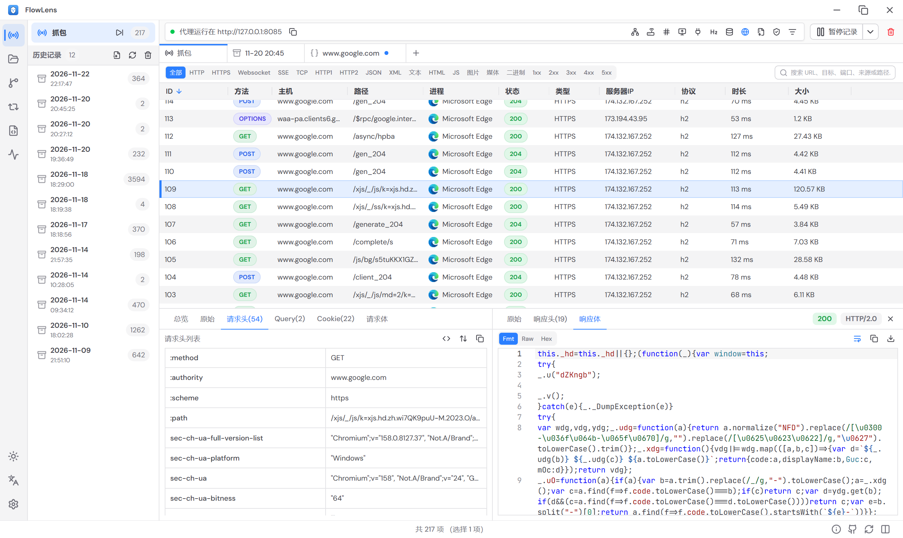
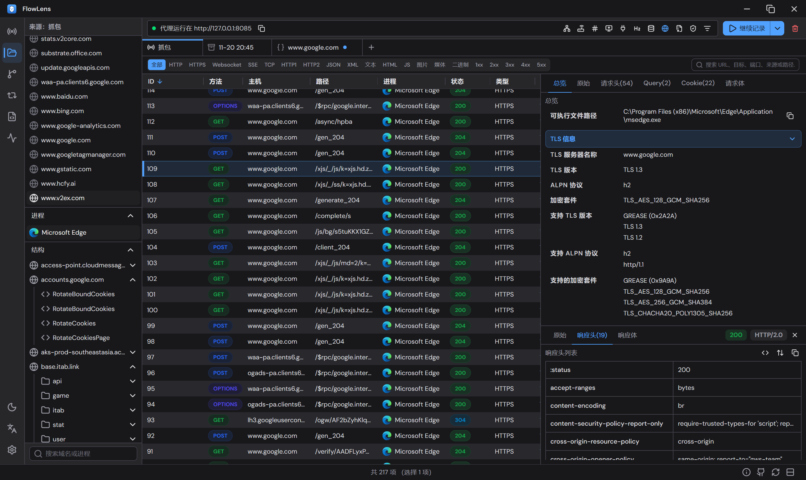

<p align="center">
  
</p>

<h1 align="center">FlowLens</h1>

<p align="center">
  一款本地优先的桌面端 MITM 流量分析工具，支持 HTTP、HTTPS、WebSocket 与 SOCKS5 工作流。
</p>

<p align="center">
  <a href="https://github.com/josexy/flowlens/actions/workflows/ci.yml"></a>
  <a href="https://github.com/josexy/flowlens/releases/latest"></a>
  <a href="LICENSE"></a>
</p>

<p align="center">
  <a href="README.md">English</a> · <strong>简体中文</strong>
</p>

FlowLens 支持捕获代理流量，以及查看、编辑、重放和整理请求，使用 Go、[MyGo](https://github.com/egoist/mygo) 和 [nuxt-ui-go](https://github.com/josexy/nuxt-ui-go) 构建。

## 界面预览

### 浅色主题



### 深色主题



## 核心特性

- **流量捕获：** 支持 HTTP/HTTPS MITM、SOCKS5、SSE 和 WebSocket，可在不断开客户端连接的情况下暂停录制。
- **流量检视：** 查看有序 Header 与 Trailer、传输耗时和体积，以及文本、图像和十六进制正文。
- **发送与重放：** HTTP 请求编辑器和 WebSocket 客户端支持代理选择、TLS 指纹、HTTP/2 指纹及共享 DNS 缓存。
- **实时重写：** 重定向 URL，修改实时 HTTP/HTTPS 流量的 Header、查询参数和 UTF-8 正文，并预览正则替换结果。
- **整理与脚本：** 使用 API Collections、本地历史、流量分类，以及带独立标签页控制台的可选 Python 3 Hook。
- **导入与导出：** 导入 HAR；将抓包或历史导出为 CSV/HAR，或单独保存请求、响应、Header 和正文。
- **桌面集成：** 支持本地进程归属、签名更新、快捷键、主题和中英文界面。Windows 与 macOS 还提供系统代理和当前用户 CA 信任管理。

## 安装

从 [GitHub Releases](https://github.com/josexy/flowlens/releases/latest) 下载最新版本。

| 平台 | 安装包 |
| --- | --- |
| Windows x64 / ARM64 | NSIS 安装程序 |
| macOS | Apple Silicon DMG 或通用（Universal）DMG |
| Linux x64 / ARM64 | Debian 安装包（`.deb`）、RPM 安装包（`.rpm`），或 `.tar.gz` 压缩包配合 `install.sh` |

Linux 安装包使用 GTK 3 渲染原生界面，无需依赖 WebKitGTK。

请使用 `SHA256SUMS` 校验下载文件。Windows 安装包未签名，macOS 安装包仅使用 ad-hoc 签名（未公证），首次启动时出现操作系统安全提示属于正常现象。

通过状态栏检查更新，选择 **安装并重启** 后，FlowLens 会先下载并验证更新，再重启应用。安装目录不可写时，需前往发布页面手动安装。取消和重启选项见[更新指南（English）](docs/user-guide.md#update-flowlens)。

从 1.0.x 升级需手动安装一次 2.0.0 或更高版本，原有数据会保留。

## 快速开始

1. 在工具栏启动代理，并将客户端指向 `127.0.0.1:8080`。
2. 如需解密 HTTPS，打开 **设置 > 代理**，使用内置 CA，或选择自己的证书和私钥。
3. 在客户端信任该 CA。Windows 与 macOS 可通过盾牌按钮为当前用户安装；使用独立信任库的客户端需手动配置。

详细抓包、证书与系统代理配置请参阅[用户指南（English）](docs/user-guide.md#set-up-capture)。

## 从源码构建

使用 [go.mod](go.mod) 指定版本或更新版本的 Go，并安装 [Task](https://taskfile.dev)。应用构建使用 `CGO_ENABLED=0`，无需 C 编译器或 Node.js。Python Hook 需要外部 Python 3 解释器。

```shell
git clone https://github.com/josexy/flowlens.git
cd flowlens
task dev
```

开发命令见 [Contributing](CONTRIBUTING.md)；平台要求、直接调用 MyGo 的方法及发布流程见[构建与打包指南](docs/technical/building.md)。

## 文档导航

| 文档 | 内容说明 |
| --- | --- |
| [User Guide（English）](docs/user-guide.md) | 抓包配置、证书管理、流量检视、历史与 HAR、请求编辑器、API Collections、重写规则、快捷键、设置与本地存储 |
| [Python 插件指南（简体中文）](docs/technical/python-plugins.zh-CN.md) · [English](docs/technical/python-plugins.md) | Python 环境配置、Hook API、限制说明、故障排查及[已测试示例](docs/examples/python-plugins) |
| [HTTP Rewrite Rules（English）](docs/technical/http-rewrite-rules.md) | 匹配语义、正文处理、资源限制与生命周期 |
| [Traffic Metrics and HAR（English）](docs/technical/traffic-metrics-and-har.md) | 耗时与体积定义、HAR 映射规则、HBIN 历史格式、录制准入与内存管理 |
| [Building and Packaging（English）](docs/technical/building.md) | Cgo 策略、各平台打包、签名更新、发布流程及 [macOS 原生验证](docs/technical/macos-native-verification.md) |
| [Memory Diagnostics（English）](docs/technical/memory-diagnostics.md) | 空闲内存行为、常驻缓存边界与运行中实例性能剖析 |
| [Contributing](CONTRIBUTING.md) · [Engineering Guidelines](AGENTS.md) | 贡献流程、测试验证与仓库工程规范 |
| [Changelog](CHANGELOG.md) · [Security Policy](SECURITY.md) | 版本更新日志与安全漏洞上报说明 |

## 数据与安全

FlowLens 将所有本地数据保存在操作系统的用户配置目录中，详见[本地存储（English）](docs/user-guide.md#local-storage)。

- 请仅在归你所有或已获授权的流量与系统上使用 FlowLens。
- 监听 `ALL`（`0.0.0.0`）会将代理暴露给所有能够访问本机的网络设备。
- 请妥善保管 MITM CA 私钥，不再使用时及时从系统信任库中移除该 CA 证书。
- 抓包记录、历史、导出文件及日志可能包含凭据与其他敏感信息，导出内容不会自动脱敏。
- Python 插件以可信本地代码运行，拥有与当前用户相同的权限，不提供安全沙箱。

更多安全说明请参阅用户指南中的[安全章节](docs/user-guide.md#security)。如发现安全漏洞，请通过 [SECURITY.md](SECURITY.md) 上报，切勿公开提交 Issue。

## 参与贡献与问题反馈

提交代码或文档改动前，请先阅读 [CONTRIBUTING.md](CONTRIBUTING.md)。遇到可复现的 Bug 或有明确的功能建议，请提交 [GitHub Issues](https://github.com/josexy/flowlens/issues)，提交前务必清除其中的凭据、抓包内容、私人路径、证书和未脱敏日志。

## 许可证

FlowLens 依据 [LICENSE](LICENSE) 中的条款开源。
